

  <picture>
    <source media="(prefers-color-scheme: dark)" srcset="./docs/logo-dark.svg">
    <source media="(prefers-color-scheme: light)" srcset="./docs/logo-light.svg">
    
  </picture>
  
  # ProntaComanda
  ### Centro Paula Souza
  ### Faculdade de Tecnologia de Jahu 
  ### Curso de Tecnologia em Desenvolvimento de Software Multiplataforma
  ### Jaú, SP, BR
  ### Início: 3º Semestre / 2026
  # Documentação da Aplicação Web

# Autores:
<h3 align="center">
   &nbsp;
  <a href="https://www.linkedin.com/in/joaosurita/">João Pedro Surita</a>;
  <a href="https://www.linkedin.com/in/brunoobrunelli/">Bruno Oller Brunelli</a>;
  <a href="https://www.linkedin.com/in/eduardo-petarnella-gabri-18986b353/">Eduardo Petarnella Gabri</a>.
</h3>

<h1>Sumário</h1>

  - [1. Resumo da aplicação web](#1-resumo-da-aplicação-web)
    - [1.1. Objetivos](#11-objetivos)
    - [1.2. Métodos da pesquisa](#12-métodos-da-pesquisa)
  - [2. Plano de negócio do cliente](#2-plano-de-negócio-do-cliente)
    - [2.1. Perfil do cliente](#21-perfil-do-cliente)
    - [2.2. Cenário atual](#22-cenário-atual)
    - [2.3. Dores identificadas](#23-dores-identificadas)
    - [2.4. Objetivos de negócio e de mercado](#24-objetivos-de-negócio-e-de-mercado)
  - [3. Especificação de requisitos](#3-especificação-de-requisitos)
    - [3.1. Requisitos funcionais](#31-requisitos-funcionais)
    - [3.2. Requisitos não funcionais](#32-requisitos-não-funcionais)
    - [3.3. Regras de negócio](#33-regras-de-negócio)
    - [3.4. Alterações de escopo em relação à especificação original](#34-alterações-de-escopo-em-relação-à-especificação-original)
    - [3.5. Correspondência com a numeração do código](#35-correspondência-com-a-numeração-do-código)
  - [4. Proposta de valor (solução)](#4-proposta-de-valor-solução)
    - [4.1. Como o ProntaComanda resolve cada dor](#41-como-o-prontacomanda-resolve-cada-dor)
    - [4.2. Antes e depois](#42-antes-e-depois)
    - [4.3. Canvas do modelo de negócios](#43-canvas-do-modelo-de-negócios)
  - [5. Estudo de viabilidade](#5-estudo-de-viabilidade)
  - [6. Design](#6-design)
  - [7. Protótipo](#7-protótipo)
  - [8. Aplicação](#8-aplicação)
    - [8.1. Arquitetura](#81-arquitetura)
    - [8.2. Tecnologias](#82-tecnologias)
    - [8.3. Módulos e telas](#83-módulos-e-telas)
    - [8.4. API e tempo real](#84-api-e-tempo-real)
    - [8.5. Execução e implantação](#85-execução-e-implantação)
    - [8.6. Situação atual do projeto](#86-situação-atual-do-projeto)
  - [9. Diagramas da aplicação](#9-diagramas-da-aplicação)
    - [9.1. Diagrama de Casos de Uso](#91-diagrama-de-casos-de-uso)
    - [9.2. Diagrama de Classes](#92-diagrama-de-classes)
    - [9.3. Diagrama de Banco de Dados](#93-diagrama-de-banco-de-dados)
    - [9.4. Diagramas de Estados](#94-diagramas-de-estados)
    - [9.5. Diagramas de Sequência](#95-diagramas-de-sequência)
  - [10. Considerações finais](#10-considerações-finais)
  - [Referências bibliográficas](#referências-bibliográficas)

# 1. Resumo da aplicação web
O ProntaComanda é um sistema web desenvolvido para otimizar a gestão operacional de estabelecimentos gastronômicos, eliminando gargalos no atendimento e modernizando o controle interno de pedidos. O principal objetivo é centralizar e agilizar o fluxo de trabalho, conectando cliente, salão, cozinha/bar, caixa e gestão em um único sistema, de forma prática, remota e eficiente.

Por meio de interfaces específicas para cada perfil de usuário, o sistema permite o gerenciamento de mesas e comandas, a transmissão automática dos pedidos para a cozinha e o bar (KDS, *Kitchen Display System*) e a atualização em tempo real do mapa de mesas e da disponibilidade dos itens do cardápio. O próprio cliente também pode fazer o pedido pelo celular, a partir de um QR code: o pedido fica pendente até que o garçom o confira no salão e o aceite, e só então segue para a produção. Isso reduz erros de anotação e minimiza o tempo de espera dos clientes, elevando o padrão de serviço oferecido.

Além de aprimorar a experiência do consumidor, o ProntaComanda oferece uma visão estratégica para o negócio: controle de estoque de insumos com histórico de movimentações, fechamento de conta por mesa ou por comanda com múltiplas formas de pagamento, trilha de auditoria das ações sensíveis e um dashboard com indicadores de faturamento e produtividade, exportável em PDF. Dessa forma, a plataforma promove não apenas agilidade no atendimento, mas também uma maior eficiência administrativa para empreendedores que buscam profissionalizar a gestão de seus estabelecimentos.

## 1.1. Objetivos
### Objetivo geral
Desenvolver uma aplicação web que digitalize e centralize o fluxo de comandas de bares e restaurantes, conectando cliente, salão, cozinha e gestão em um único sistema.

### Objetivos específicos
  - Substituir a comanda de papel por um registro digital de consumo por mesa, com várias comandas simultâneas na mesma mesa;
  - Enviar os pedidos do salão automaticamente para a cozinha/bar, em tempo real, sem deslocamento do garçom;
  - Permitir que o cliente faça o pedido e acompanhe o consumo pelo celular, com conferência do garçom;
  - Manter o cardápio atualizado, ativando ou desativando itens, inclusive conforme o estoque de insumos;
  - Controlar o estoque de insumos com histórico de entradas, saídas e ajustes;
  - Realizar o fechamento da conta por mesa ou por comanda, com múltiplas formas de pagamento e cálculo de troco;
  - Fornecer ao gestor relatórios de faturamento e produtividade para apoiar decisões;
  - Restringir as funções do sistema por perfil de usuário (Administrador, Caixa, Garçom, Cozinha e Bar);
  - Registrar em auditoria as ações sensíveis (estornos, descontos, ajustes de estoque, entre outras).

## 1.2. Métodos da pesquisa
O desenvolvimento deste projeto conta com o apoio da infraestrutura da Fatec de Jahu. As atividades são realizadas tanto durante as aulas quanto em horários livres, utilizando os computadores dos laboratórios da instituição, assim como os dispositivos pessoais dos membros da equipe.

Para a criação da interface, o front-end é uma aplicação de página única (SPA) construída com **React** e **Vite**, estilizada com **Tailwind CSS** e com suporte a tema claro e escuro. O protótipo visual foi elaborado no **Figma**, que permite a colaboração entre os integrantes e facilita a definição do design das telas.

O back-end é uma API REST implementada em **Node.js** com **Express**, e o banco de dados é o **MongoDB**, acessado por meio do **Mongoose**. A comunicação em tempo real entre salão, cozinha e caixa usa **Socket.IO**; a autenticação usa **JWT** em cookie *httpOnly*, com senhas protegidas por **argon2**; e os dados de entrada são validados com **Zod**. O sistema é empacotado com **Docker** (Docker Compose) e também pode ser executado em **Kubernetes**. O código-fonte é editado no Visual Studio Code e gerenciado por meio do **Git** e do GitHub, seguindo o padrão *Conventional Commits*, garantindo controle das versões e organização durante todo o processo de desenvolvimento.

<h3 align="center">
   &nbsp;&nbsp;
   &nbsp;&nbsp;
   &nbsp;&nbsp;
   &nbsp;&nbsp;
   &nbsp;&nbsp;
   &nbsp;&nbsp;
   &nbsp;&nbsp;
   &nbsp;&nbsp;
   &nbsp;&nbsp;
   &nbsp;&nbsp;
   &nbsp;&nbsp;
  
</h3>

Todo o projeto está sendo desenvolvido nas instalações da Fatec de Jahu, que fornece a infraestrutura e o suporte necessários para a execução das atividades. As tarefas são realizadas ao longo do semestre do curso, integrando-se aos conteúdos das disciplinas, o que permite aplicar de forma prática os conhecimentos adquiridos em sala de aula.

[Voltar para o início](#inicio)

# 2. Plano de negócio do cliente
Esta seção descreve o cliente para o qual o ProntaComanda foi pensado, o cenário em que ele opera hoje, os problemas que enfrenta e o que deseja alcançar. É a base que justifica cada requisito e cada decisão de projeto apresentados nas seções seguintes.

## 2.1. Perfil do cliente
O cliente-alvo é o **pequeno e médio estabelecimento gastronômico** com atendimento em mesas: restaurantes, bares e pubs, lanchonetes e cafeterias, e food trucks com atendimento local. Em geral, são negócios administrados diretamente pelo proprietário, com equipe enxuta (gestor, garçons e cozinha/bar) e pouco investimento em tecnologia.

## 2.2. Cenário atual
Nesse tipo de negócio, o fluxo de atendimento costuma ser majoritariamente manual:

  1. O garçom anota o pedido em uma comanda de papel;
  2. Leva o pedido até a cozinha ou o bar, ou o repassa verbalmente;
  3. A cozinha prepara sem visibilidade do que está pendente ou atrasado;
  4. No fechamento, a conta é somada à mão a partir das anotações;
  5. O cardápio e o estoque são controlados de memória ou em planilhas soltas;
  6. O gestor só tem noção do faturamento ao final do dia ou do mês, sem indicadores de produtividade;
  7. O cliente depende do garçom para fazer novos pedidos e para conferir o que já consumiu.

Os sistemas de gestão (ERP) existentes no mercado costumam ser complexos e caros para esse porte de negócio, o que leva muitos empreendedores a permanecerem no processo manual.

## 2.3. Dores identificadas

| ID | Dor | Consequência para o negócio |
|:--:|-----|-----------------------------|
| D1 | Erros de anotação e de interpretação de pedidos manuais | Retrabalho, desperdício de insumos e clientes insatisfeitos |
| D2 | Comunicação lenta ou falha entre salão e cozinha | Pratos atrasados, mesas esperando, baixo giro de mesas |
| D3 | Cardápio desatualizado (item oferecido, mas em falta) | Frustração do cliente e retrabalho do garçom |
| D4 | Falta de visão sobre a ocupação das mesas | Dificuldade de organizar o atendimento e distribuir as demandas |
| D5 | Fechamento de conta manual, sujeito a erros de soma e cobrança | Perda de receita ou cobrança indevida |
| D6 | Ausência de dados para gestão (faturamento, itens mais vendidos, tempo de preparo) | Decisões tomadas por intuição |
| D7 | Qualquer funcionário pode mexer em qualquer informação | Falta de controle e risco de fraude ou erro |
| D8 | Dependência do garçom para fazer pedidos e acompanhar o consumo | Espera para ser atendido, pedidos adicionais atrasados e conta sem transparência |

## 2.4. Objetivos de negócio e de mercado
  - **Reduzir erros de pedido** e retrabalho no atendimento;
  - **Reduzir o tempo de espera** do cliente, melhorando a experiência e o giro de mesas;
  - **Dar autonomia ao cliente** para pedir e acompanhar o consumo, mantendo a conferência do garçom;
  - **Dar previsibilidade e controle** ao gestor sobre consumo, cardápio, estoque e faturamento;
  - **Profissionalizar a gestão** com uma ferramenta simples e de baixo custo, sem a complexidade de um ERP;
  - **Acompanhar a transformação digital** do setor de Food Service, tornando-se acessível a micro e pequenos empreendedores.

[Voltar para o início](#inicio)

# 3. Especificação de requisitos
Um documento de requisitos de sistema descreve o que o sistema deve fazer, suas funções, regras e limitações. Ele serve como guia para o desenvolvimento, ajudando a garantir que o sistema atenda às necessidades dos usuários e funcione corretamente.

Os requisitos são divididos em dois grupos:

| | Requisitos Funcionais (RF) | Requisitos Não Funcionais (RNF) |
|---|---|---|
| **O que definem** | O que o sistema **faz**: funcionalidades e comportamentos | **Como** o sistema deve ser: qualidade, restrições e padrões |
| **Exemplo neste projeto** | RF6: adicionar produtos à comanda de uma mesa | RNF1: responder às ações do usuário em até 2 segundos |
| **Como verificar** | O usuário consegue (ou não) executar a função | Medição de desempenho, segurança, usabilidade etc. |

**Prioridade:** *Alta* = essencial para o sistema funcionar (MVP); *Média* = importante, mas pode ser entregue em uma segunda etapa.

**Situação:** estado de cada requisito no código atual. *Implementado* = funciona de ponta a ponta; *Parcial* = existe, mas falta algo (descrito na própria linha); *Não implementado* = ainda não existe.

## 3.1. Requisitos funcionais

### Módulo: Cardápio
| ID | Requisito | Descrição | Prioridade | Dor | Situação |
|:--:|-----------|-----------|:----------:|:---:|----------|
| RF1 | Cadastro de Produtos | O sistema deve permitir a inclusão, alteração e inativação de itens (nome, preço, categoria, descrição, foto, ingredientes, setor de preparo e tempo de preparo). A exclusão é lógica: o item inativado deixa de aparecer, mas permanece nas comandas antigas. | Alta | D3 | Implementado |
| RF2 | Controle de Disponibilidade | O sistema deve ativar ou desativar itens do cardápio, refletindo a mudança imediatamente em todos os dispositivos conectados, inclusive de forma automática quando o insumo vinculado ao item zerar. | Alta | D3 | **Parcial:** a disponibilidade manual e a propagação em tempo real funcionam; a desativação automática por estoque está programada, mas ainda não há tela nem rota para vincular produtos a insumos (ficha técnica). |
| RF3 | Categorização de Itens | O sistema deve permitir agrupar produtos por categoria (ex: Entradas, Bebidas). Uma categoria com produtos ativos não pode ser inativada. | Alta | D3 | Implementado |

### Módulo: Autoatendimento do cliente
| ID | Requisito | Descrição | Prioridade | Dor | Situação |
|:--:|-----------|-----------|:----------:|:---:|----------|
| RF15 | Cardápio Digital Público | O cliente deve acessar o cardápio pelo celular, sem login (via QR code ou link), navegando por categoria e buscando por nome, descrição ou preço. Itens esgotados aparecem desabilitados. | Alta | D3, D8 | Implementado |
| RF16 | Pedido pelo Cliente | O cliente deve montar o carrinho, escolher a mesa e enviar o pedido. O pedido fica pendente até o garçom aceitar (os itens seguem para a cozinha/bar e a mesa fica ocupada) ou recusar (com motivo). | Alta | D1, D2, D8 | Implementado |
| RF17 | Acompanhamento pelo Cliente | O cliente deve ver o andamento de cada item e a comanda compartilhada da mesa. A comanda some da tela dele quando a conta é paga. | Média | D2, D8 | Implementado |

### Módulo: Mesas e comandas
| ID | Requisito | Descrição | Prioridade | Dor | Situação |
|:--:|-----------|-----------|:----------:|:---:|----------|
| RF4 | Monitoramento de Status | O sistema deve exibir em tempo real se a mesa está livre, ocupada ou aguardando fechamento, com cronômetro desde a abertura. | Alta | D4 | Implementado |
| RF5 | Abertura de Comanda | O sistema deve vincular o início de um atendimento a uma numeração de mesa específica. Uma mesa pode ter várias comandas abertas ao mesmo tempo, numeradas em sequência. | Alta | D1, D4 | Implementado |
| RF6 | Lançamento de Consumo | O sistema deve permitir adicionar produtos à comanda ativa de uma mesa, com quantidade e observação, sugerindo as observações mais usadas para cada produto. | Alta | D1 | Implementado |
| RF7 | Remanejamento de Mesa | O sistema deve permitir transferir itens para outra comanda aberta (da mesma mesa ou de outra), preservando o rastro de origem. | Média | D4 | **Parcial:** implementado na API (`POST /comandas/:id/transferir`), mas sem tela no frontend. |
| RF21 | Solicitação de Fechamento | O garçom deve poder marcar a mesa como "aguardando fechamento", sinalizando o caixa em tempo real. Nesse estado a mesa não aceita novas comandas nem pedidos de clientes. | Média | D4, D5 | Implementado |
| RF22 | Gestão de Mesas | O Administrador deve poder criar e remover (inativar) mesas do salão. Só mesas livres podem ser removidas. | Média | D4 | Implementado |

### Módulo: Cozinha e bar
| ID | Requisito | Descrição | Prioridade | Dor | Situação |
|:--:|-----------|-----------|:----------:|:---:|----------|
| RF8 | Transmissão de Pedidos | O sistema deve enviar automaticamente, em tempo real, cada item lançado para o setor responsável (cozinha ou bar), definido no cadastro do produto. | Alta | D2 | Implementado |
| RF9 | Gestão de Preparo | O sistema deve atualizar o estágio do item: Pendente, Em Preparo, Pronto e Entregue. | Alta | D2 | Implementado |
| RF10 | Log de Tempo | O sistema deve registrar o tempo decorrido entre o pedido e a entrega e sinalizar atrasos, com base no tempo de preparo cadastrado no produto (semáforo no KDS). | Média | D2, D6 | **Parcial:** os horários de lançamento, início do preparo, pronto e entrega são gravados por item e o semáforo funciona; ainda não há relatório de tempo médio de preparo. |

### Módulo: Estoque
| ID | Requisito | Descrição | Prioridade | Dor | Situação |
|:--:|-----------|-----------|:----------:|:---:|----------|
| RF18 | Cadastro de Insumos | O Administrador deve cadastrar insumos (nome, unidade, saldo atual e saldo mínimo), com inativação lógica. | Média | D3 | Implementado |
| RF19 | Movimentação de Estoque | O sistema deve registrar entradas, saídas e ajustes por contagem (com motivo obrigatório), mantendo o histórico de quem movimentou e do saldo antes e depois. O saldo nunca fica negativo. | Média | D3, D6 | Implementado |
| RF20 | Alerta de Ruptura | Quando o saldo de um insumo zera, os produtos que dependem dele devem ficar indisponíveis em todos os dispositivos e voltar a ficar disponíveis na reposição. A tela de estoque destaca os insumos zerados e abaixo do mínimo. | Média | D3 | **Parcial:** o alerta visual funciona; a indisponibilização automática de produtos depende do vínculo produto-insumo, ainda não configurável (ver RF2). |

### Módulo: Fechamento de conta
| ID | Requisito | Descrição | Prioridade | Dor | Situação |
|:--:|-----------|-----------|:----------:|:---:|----------|
| RF11 | Cálculo de Subtotal | O sistema deve somar automaticamente todos os itens consumidos na comanda, desconsiderando os estornados. | Alta | D5 | Implementado |
| RF12 | Ajuste de Valores | O sistema deve permitir aplicar desconto (percentual ou em reais, com observação) no total da comanda. Restrito ao Administrador. | Média | D5 | Implementado (taxa de serviço e cortesia saíram do escopo, ver 3.4) |
| RF23 | Pagamento | O caixa deve registrar o pagamento da mesa inteira ou de uma comanda específica (divisão de conta), em até 5 formas (Pix, cartão e dinheiro), com cálculo de troco. Valor menor que o total é recusado. A mesa volta a ficar livre quando não restar comanda aberta. | Alta | D5 | Implementado |
| RF24 | Estorno de Item | O caixa ou o Administrador deve poder estornar um item lançado, com motivo obrigatório. O item deixa de contar no total e no KDS, e o estorno é auditado. | Média | D1, D5, D7 | Implementado |
| RF25 | Reabertura de Mesa | O Administrador deve poder desfazer um fechamento feito por engano: as comandas do último pagamento são reabertas, o pagamento é estornado e a mesa volta a ficar ocupada. | Média | D5, D7 | Implementado (por mesa; não há desfazer para uma comanda avulsa) |

### Módulo: Gestão e segurança
| ID | Requisito | Descrição | Prioridade | Dor | Situação |
|:--:|-----------|-----------|:----------:|:---:|----------|
| RF13 | Controle de Acesso | O sistema deve restringir funções e telas por perfil (Administrador, Caixa, Garçom, Cozinha e Bar), com login por CPF e senha e sessão contínua (8 horas). | Alta | D7 | Implementado |
| RF14 | Relatório de Vendas | O sistema deve apresentar indicadores de faturamento e produtividade (ganhos, total de pedidos, ticket médio, cancelamentos, taxa de conversão, status dos pedidos, top 5 produtos e faturamento dos últimos 12 meses) por período (hoje, semana ou mês), com exportação em PDF. | Média | D6 | Implementado |
| RF26 | Gestão de Funcionários | O Administrador deve cadastrar, editar, desligar e reativar funcionários (CPF válido e único). Não é possível desligar a própria conta nem o último administrador ativo. | Alta | D7 | Implementado |
| RF27 | Auditoria | O sistema deve registrar e permitir consultar, com filtros por tipo, funcionário e período, as ações sensíveis: estornos, descontos, reaberturas, ajustes de estoque, alterações de funcionários e de preço/inativação de produtos, além de erros do sistema. | Média | D7 | Implementado |
| RF28 | Consolidação Mensal | Todo dia 1º, às 00:05 (fuso do estabelecimento), o sistema deve consolidar o mês anterior em um resumo e remover os registros detalhados já consolidados, sem ação do usuário. Ao iniciar, recupera meses pendentes. | Média | D6 | Implementado |

## 3.2. Requisitos não funcionais

| ID | Categoria | Descrição | Como verificar | Situação |
|:--:|-----------|-----------|----------------|----------|
| RNF1 | Desempenho | O sistema deve responder às ações do usuário (abrir mesa, lançar item, consultar cardápio) em até 2 segundos em condições normais de uso, e refletir novos pedidos na tela da cozinha em poucos segundos. | Teste de tempo de resposta | **Parcial:** a atualização da cozinha é em tempo real (WebSocket) e as consultas usam índices, mas não há medição formal. |
| RNF2 | Usabilidade | A interface deve ser intuitiva e adaptável a diferentes tamanhos de tela, como computadores, tablets e celulares, permitindo que um novo funcionário execute as tarefas básicas com pouco treinamento. | Teste com usuários | **Parcial:** telas separadas por perfil (garçom e cliente em formato mobile; administração em desktop) e tema claro/escuro; falta teste com usuários. |
| RNF3 | Portabilidade | O sistema deve funcionar corretamente nos principais navegadores de internet e dispositivos móveis. | Teste em navegadores e dispositivos | **Parcial:** aplicação web responsiva; sem bateria formal de testes entre navegadores. |
| RNF4 | Manutenibilidade | O sistema deve ser de fácil manutenção, com documentação clara e organizada e arquitetura em camadas no padrão MVC (rotas, controladores e modelos no back-end; interface em React no front-end). | Revisão de código e documentação | Implementado (sem testes automatizados). |
| RNF5 | Suporte | Deve ser disponibilizado suporte técnico para solucionar eventuais problemas no funcionamento da aplicação. | Canal de suporte definido | Não implementado (fora do escopo acadêmico; o README do projeto traz um guia de problemas comuns). |
| RNF6 | Segurança | O sistema deve proteger as informações dos usuários, com autenticação, senhas armazenadas de forma criptografada e acesso às funções conforme o perfil, assegurando privacidade e integridade dos dados. | Teste de autenticação e permissões | **Parcial:** senhas com argon2, JWT em cookie *httpOnly*, RBAC validado no back-end, validação de entrada com Zod, *helmet* e limite de tentativas de login. Pendências: o Socket.IO não exige login e o ambiente de demonstração roda em HTTP e com o MongoDB sem senha. |
| RNF7 | Disponibilidade | O sistema deve estar disponível para uso durante o horário de funcionamento do estabelecimento, com interrupções mínimas e programadas fora do horário de pico. | Monitoramento de disponibilidade | **Parcial:** verificações de saúde e reinício automático (Docker e Kubernetes); o back-end roda com uma única réplica e não há monitoramento. |
| RNF8 | Controle de versão | O desenvolvimento será acompanhado de boas práticas de versionamento (Git/GitHub) para facilitar a gestão e a rastreabilidade das mudanças. | Histórico de commits | Implementado (Conventional Commits e integração contínua que compila as imagens). |
| RNF9 | Acessibilidade | O sistema deve respeitar padrões de acessibilidade (contraste adequado, textos legíveis, navegação por teclado) para garantir o uso por pessoas com diferentes necessidades. | Checklist de acessibilidade | **Parcial:** foco visível, rótulos ARIA, respeito à preferência de menos animação e temas claro/escuro; sem auditoria formal. |
| RNF10 | Tolerância a falhas | O sistema deve garantir que os dados não sejam perdidos em caso de falhas, mantendo cópias de segurança do banco de dados. | Teste de restauração de backup | **Parcial:** dados em volumes persistentes e tratamento global de erros com logs; o backup (`mongodump`) ainda não foi implementado. |
| RNF11 | Interoperabilidade | O sistema deve permitir a exportação dos dados de vendas em formatos comuns (como CSV ou PDF), para uso em outras soluções administrativas, como controle financeiro e contabilidade. | Teste de exportação | **Parcial:** exportação em PDF do relatório do Dashboard; CSV não implementado. |
| RNF12 | Rastreabilidade e integridade histórica | Registros importantes não devem ser apagados nem alterados retroativamente: exclusão lógica, cópia de nome e preço no item lançado e trilha de auditoria. | Revisão do modelo de dados e consulta à auditoria | Implementado |
| RNF13 | Implantação em contêineres | O sistema deve poder ser executado com um único comando em Docker Compose e também em Kubernetes, com dados persistentes e dados de exemplo para demonstração. | Execução do guia de instalação | Implementado (configuração de demonstração, não de produção). |

## 3.3. Regras de negócio
As regras de negócio (RN) são as políticas do estabelecimento que o sistema deve respeitar.

### Mesas e comandas
| ID | Regra |
|:--:|-------|
| RN1 | Uma comanda pode ser aberta para uma mesa **livre** ou **ocupada**. Mesa **aguardando fechamento** não aceita novas comandas. |
| RN2 | Uma mesa pode ter várias comandas abertas ao mesmo tempo, numeradas em sequência por mesa (#001, #002...). |
| RN3 | O status da mesa segue: livre → ocupada (ao abrir) → aguardando fechamento (ao solicitar, só a partir de ocupada) → livre (ao quitar todas as comandas). |
| RN4 | Só é possível remover uma mesa livre. O número de uma mesa removida pode ser reutilizado. |
| RN5 | Itens só podem ser transferidos para uma comanda aberta. |

### Pedido, produção e KDS
| ID | Regra |
|:--:|-------|
| RN6 | Itens desativados ou indisponíveis no cardápio não podem ser lançados em novas comandas, nem pelo garçom nem pelo cliente. |
| RN7 | Todo item lançado gera um pedido para a cozinha ou o bar, conforme o setor definido no cadastro do produto; o setor informado pelo aplicativo é ignorado. |
| RN8 | Nome, preço e tempo de preparo do produto são copiados para o item no lançamento: alterar o cardápio depois não muda contas antigas. |
| RN9 | O estágio de um item segue a ordem: Pendente, Em Preparo, Pronto, Entregue. O avanço pela interface é sempre em sequência. |
| RN10 | O prazo de um pedido no KDS é o maior tempo de preparo entre seus itens (20 minutos quando nenhum tem tempo cadastrado). O tempo fica amarelo ao atingir 70% do prazo e o pedido vira "atrasado" ao ultrapassá-lo. |
| RN11 | As observações digitadas alimentam as sugestões: são oferecidas as 5 mais usadas de cada produto. |

### Fechamento e pagamento
| ID | Regra |
|:--:|-------|
| RN12 | O total da comanda é a soma dos itens não estornados menos o desconto. |
| RN13 | Somente os perfis **Caixa** e **Administrador** estornam itens, e o estorno exige motivo e gera auditoria. |
| RN14 | Somente o **Administrador** aplica desconto, em percentual ou em reais; a ação gera auditoria. |
| RN15 | O pagamento aceita até 5 formas (Pix, cartão e dinheiro). Valor recebido menor que o total é recusado, informando quanto falta; o excedente vira troco. |
| RN16 | Pagar a mesa fecha todas as suas comandas abertas; pagar uma comanda não afeta as demais. A mesa só volta a **livre** quando não restar comanda aberta. |
| RN17 | Somente o **Administrador** reabre uma mesa já paga: as comandas do último pagamento são reabertas, o pagamento é marcado como estornado (e ignorado pelo dashboard) e a ação gera auditoria. |

### Autoatendimento
| ID | Regra |
|:--:|-------|
| RN18 | O pedido do cliente fica **pendente** até um garçom, caixa ou administrador aceitar. Só no aceite a mesa fica ocupada e os itens seguem para o KDS. A recusa exige motivo e não lança nada. Se dois funcionários tocarem em Aceitar ao mesmo tempo, só um vence. |
| RN19 | Preço e nome vêm sempre do cadastro, nunca do cliente. Produto indisponível bloqueia o envio. Cada item aceita até 20 unidades e observação de até 140 caracteres. |
| RN20 | Cada mesa pode ter no máximo 5 pedidos pendentes, e mesa aguardando fechamento não recebe pedidos. |
| RN21 | O cliente só enxerga a comanda de uma mesa se tiver ao menos um pedido **aceito** nela. Quando a conta é paga, a comanda some da tela dele. |

### Cardápio e estoque
| ID | Regra |
|:--:|-------|
| RN22 | Uma categoria com produtos ativos não pode ser inativada. |
| RN23 | O saldo de um insumo só muda por movimentação (entrada, saída ou ajuste), sempre com histórico, e nunca fica negativo. O ajuste exige motivo e gera auditoria. |
| RN24 | Zerar um insumo torna indisponíveis os produtos que dependem dele, e repor volta a liberá-los (depende do vínculo produto-insumo, ver RF20). |

### Acesso e dados
| ID | Regra |
|:--:|-------|
| RN25 | As funções de cada perfil seguem a matriz de permissões abaixo; o back-end valida o perfil em toda requisição. |
| RN26 | O login usa CPF válido e senha de pelo menos 6 caracteres. Após 10 tentativas erradas em 15 minutos pelo mesmo IP, novas tentativas são bloqueadas. A sessão dura 8 horas. |
| RN27 | Funcionários, categorias, produtos, insumos e mesas são inativados, nunca apagados. O sistema nunca fica sem um administrador ativo, e ninguém desliga a própria conta. |
| RN28 | A consolidação mensal só processa meses encerrados e comandas já fechadas; uma comanda ainda aberta na virada do mês nunca é apagada. |

### Matriz de permissões por perfil

| Função | Administrador | Caixa | Garçom | Cozinha | Bar |
|--------|:---:|:---:|:---:|:---:|:---:|
| Consultar cardápio, categorias e mesas | ✓ | ✓ | ✓ | ✓ | ✓ |
| Abrir mesa e comanda, lançar itens, transferir itens, solicitar fechamento | ✓ | ✓ | ✓ | — | — |
| Aceitar ou recusar pedidos de clientes | ✓ | ✓ | ✓ | — | — |
| Mapa de mesas e tela da mesa (mobile) | ✓ | ✓ | ✓ | — | — |
| Tela de Mesas/Comandas (desktop) | ✓ | ✓ | — | — | — |
| Atualizar estágio do preparo (KDS) | ✓ | — | — | ✓ | ✓ |
| Estornar item | ✓ | ✓ | — | — | — |
| Receber pagamento | ✓ | ✓ | — | — | — |
| Aplicar desconto | ✓ | — | — | — | — |
| Reabrir mesa | ✓ | — | — | — | — |
| Criar e remover mesas | ✓ | — | — | — | — |
| Gerenciar cardápio, estoque e funcionários | ✓ | — | — | — | — |
| Consultar Dashboard e Auditoria | ✓ | — | — | — | — |

O **cliente** (sem login) só pode consultar o cardápio e enviar e acompanhar os próprios pedidos.

## 3.4. Alterações de escopo em relação à especificação original
Durante o desenvolvimento, o escopo evoluiu. A tabela resume o que mudou em relação à versão anterior desta documentação.

| Item | Especificação original | Situação atual |
|------|------------------------|----------------|
| Perfis de usuário | Admin, Garçom e Cozinheiro | Administrador, Caixa, Garçom, Cozinha e Bar (e o cliente, sem login) |
| Status da mesa | Livre, ocupada ou reservada | Livre, ocupada ou aguardando fechamento. A reserva de mesas não faz parte do escopo atual |
| Comandas por mesa | No máximo uma comanda aberta por mesa | Várias comandas simultâneas na mesma mesa |
| Estágios do pedido | Pendente, Em Preparo, Finalizado | Pendente, Em Preparo, Pronto, Entregue |
| Ajustes na conta | Descontos, cortesias e taxa de serviço | Apenas desconto. Cortesia e taxa de serviço não foram implementadas (o modelo de dados já reserva o campo da taxa) |
| Exportação de dados | CSV ou PDF | Apenas PDF (relatório do Dashboard) |
| Quem fecha a conta | Garçom | Caixa e Administrador (o garçom solicita o fechamento) |
| Tecnologias | Back-end em C#, front-end com Bootstrap, Visual Studio | Back-end em Node.js/Express, front-end em React com Tailwind CSS, Visual Studio Code |
| Módulos novos | Não previstos | Autoatendimento por QR code, estoque de insumos, pagamento, auditoria e consolidação mensal |

## 3.5. Correspondência com a numeração do código
Os comentários do código-fonte e o README do projeto usam uma numeração própria de requisitos (RF01 a RF26). A tabela relaciona cada requisito desta documentação com as referências usadas no código.

| Requisito desta documentação | Referência no código |
|------------------------------|----------------------|
| RF1, RF3 | RF03 |
| RF2 | RF03, RF22 |
| RF4 | RF04 |
| RF5 | RF20 |
| RF6 | RF07, RF21 |
| RF7 | RF25 |
| RF8 | RF05 |
| RF9 | RF05, RF06 |
| RF10 | RF06 |
| RF11 | RF11 |
| RF12 | RF09 |
| RF13 | RF01, RF18 |
| RF14 | RF13, RF17 |
| RF15, RF16, RF17 | Autoatendimento (sem numeração própria no código) |
| RF18, RF19 | RF10 |
| RF20 | RF22 |
| RF21 | RF26 |
| RF22 | RF04 |
| RF23 | RF11, RF24 |
| RF24 | RF07, RF08 |
| RF25 | RF12 |
| RF26 | RF02 |
| RF27 | RF08, RF17 |
| RF28 | RF14, RF15, RF16 |

[Voltar para o início](#inicio)

# 4. Proposta de valor (solução)
O ProntaComanda entrega ao pequeno estabelecimento gastronômico uma forma **simples, acessível e integrada** de controlar o atendimento, do pedido à conta, no lugar do papel e da comunicação verbal.

> **Proposta de valor:** facilitar o gerenciamento de estabelecimentos gastronômicos e eliminar os erros de pedidos manuais, conectando cliente, salão, cozinha e gestão em tempo real.

## 4.1. Como o ProntaComanda resolve cada dor

| Dor do cliente | Como o sistema resolve | Requisitos | Benefício esperado |
|----------------|------------------------|:----------:|--------------------|
| **D1** Erros de anotação | O garçom (ou o próprio cliente) seleciona os itens no sistema em vez de escrever à mão; o pedido chega à produção exatamente como foi lançado. | RF5, RF6, RF16, RF24 | Menos erros e retrabalho |
| **D2** Comunicação lenta salão-cozinha | O pedido é enviado automaticamente ao KDS da cozinha ou do bar, que atualiza o estágio do preparo; os horários ficam registrados e o semáforo destaca os atrasos. | RF8, RF9, RF10 | Menor tempo de espera e melhor giro de mesas |
| **D3** Cardápio desatualizado | O gestor ativa ou desativa itens e controla o estoque de insumos; a mudança vale imediatamente para todos, inclusive para o cardápio do cliente. | RF1, RF2, RF3, RF15, RF18, RF19, RF20 | Cliente não pede o que não existe |
| **D4** Falta de visão das mesas | Painel em tempo real com mesas livres, ocupadas e aguardando fechamento, com cronômetro e várias comandas por mesa. | RF4, RF5, RF7, RF21, RF22 | Atendimento mais organizado |
| **D5** Fechamento manual | O total é somado automaticamente, com desconto, estorno com motivo e pagamento por mesa ou por comanda, com troco. | RF11, RF12, RF23, RF24, RF25 | Contas corretas e sem perda de receita |
| **D6** Falta de dados | Dashboard com indicadores por período, relatório em PDF e consolidação mensal automática. | RF10, RF14, RF28 | Decisões baseadas em dados |
| **D7** Falta de controle de acesso | Cada funcionário acessa apenas as funções do seu perfil, e as ações sensíveis ficam registradas em auditoria. | RF13, RF26, RF27 | Mais segurança e responsabilização |
| **D8** Dependência do garçom | O cliente faz o pedido e acompanha o consumo pelo celular; o garçom confere antes de o pedido seguir para a produção. | RF15, RF16, RF17 | Mais autonomia para o cliente, sem perder o controle do salão |

## 4.2. Antes e depois

| Situação | Sem o ProntaComanda | Com o ProntaComanda |
|----------|---------------------|---------------------|
| Registro do pedido | Papel, escrita à mão | Lançamento digital por mesa, pelo garçom ou pelo próprio cliente |
| Envio à cozinha | Garçom leva ou repassa verbalmente | Automático e instantâneo, para cozinha ou bar |
| Acompanhamento do preparo | Sem visibilidade | Estágios Pendente, Em Preparo, Pronto e Entregue, com semáforo de atraso |
| Atualização do cardápio | Aviso verbal | Ativação/desativação centralizada, em tempo real |
| Controle de estoque | De memória ou em planilhas soltas | Insumos com saldo, alerta de saldo baixo e histórico de movimentações |
| Fechamento da conta | Soma manual | Cálculo automático, com desconto, múltiplas formas de pagamento e troco |
| Controle de acesso | Qualquer pessoa mexe em tudo | Perfis com permissões e trilha de auditoria |
| Visão gerencial | Só no fim do período, por estimativa | Dashboard por período e relatório em PDF |

## 4.3. Canvas do modelo de negócios
### Figura 1 - Canvas, modelo de negócios:

  

**O que será elaborado? (Proposta de valor)**
  - Facilitar o gerenciamento de estabelecimentos gastronômicos;
  - Eliminar erros de pedidos manuais.

**Como será elaborado?**
  - *Parcerias principais:* provedores de hospedagem e estabelecimentos gastronômicos;
  - *Atividades principais:* desenvolvimento e manutenção do software; atualização de funcionalidades do cardápio; operação da infraestrutura em contêineres;
  - *Recursos principais:* equipe de desenvolvimento, internet, plataforma de hospedagem, conteúdo e informações.

**Para quem será elaborado?**
  - *Segmento de mercado:* pequenos e médios restaurantes; bares e pubs; lanchonetes e cafeterias; food trucks com atendimento local;
  - *Relacionamento com o cliente:* autoatendimento (interface intuitiva e cardápio digital por QR code) e feedback contínuo para melhorias;
  - *Canais:* website, redes sociais e parcerias locais.

**Quanto custará?**
  - *Estrutura de custos:* domínio da aplicação; desenvolvimento e manutenção; hospedagem; suporte ao cliente;
  - *Fontes de renda:* devido ao caráter educacional e acadêmico, não estamos considerando fontes de receita.

[Voltar para o início](#inicio)

# 5. Estudo de viabilidade
### Viabilidade técnica: 
O sistema é tecnicamente viável, pois é desenvolvido com tecnologias modernas, robustas e consolidadas no mercado. O front-end utiliza React (com Vite) e Tailwind CSS para uma interface ágil e responsiva, enquanto o back-end é estruturado em Node.js com Express, garantindo alto desempenho, facilidade de manutenção e escalabilidade. A comunicação em tempo real entre salão e cozinha é viabilizada via Socket.IO (WebSockets). A persistência de dados utiliza o MongoDB com Mongoose, proporcionando um gerenciamento de dados flexível, seguro e performático. O empacotamento em contêineres (Docker) permite subir o sistema inteiro com um único comando, e os manifestos de Kubernetes demonstram o caminho para uma implantação com mais réplicas e auto-recuperação. O uso do VS Code, aliado ao Git e GitHub para versionamento, garante o suporte ideal ao trabalho colaborativo da equipe.

### Viabilidade financeira: 
O projeto demonstra alta viabilidade financeira, visto que se baseia na utilização de ferramentas de código aberto (open-source), eliminando custos elevados com licenças de software. O investimento inicial é reduzido, concentrando-se principalmente na hospedagem e manutenção básica. Ao aproveitar a infraestrutura acadêmica e tecnologias gratuitas, o ProntaComanda se posiciona como uma solução de baixo custo operacional e alta sustentabilidade econômica para micro e pequenos estabelecimentos.

### Viabilidade de mercado: 
O ProntaComanda possui forte viabilidade de mercado, inserindo-se na crescente demanda por transformação digital no setor de Food Service. Com a necessidade constante de bares e restaurantes em reduzir erros de pedido e aumentar o giro de mesas, uma ferramenta que simplifica a gestão do cardápio e o atendimento torna-se altamente competitiva. A solução atende diretamente empreendedores que buscam profissionalizar o serviço sem o alto investimento de softwares de gestão (ERP) complexos.

### Viabilidade operacional: 
O sistema é operacionalmente viável, priorizando uma interface limpa e intuitiva que se adapta à rotina acelerada de garçons e gestores. A curva de aprendizado é mínima, permitindo que a equipe comece a operar o gerenciamento de mesas e pedidos com agilidade, sem interromper o fluxo de trabalho atual. O cliente, por sua vez, não precisa instalar nenhum aplicativo: basta escanear o QR code e abrir o cardápio no navegador do celular. A centralização das informações reduz a falha de comunicação entre o salão e a cozinha, otimizando o tempo de entrega e elevando a qualidade do atendimento final.

[Voltar para o início](#inicio)

# 6. Design
### Paleta de cores:
As cores abaixo são as efetivamente usadas na aplicação (definidas em `frontend/tailwind.config.js` e `frontend/src/index.css`, a partir do protótipo do Figma). A cor de marca é um gradiente do laranja ao vermelho, usado no item ativo do menu, nos botões de ação e no nome "Comanda" do logotipo.

#### Cores de marca
| Nome | Hexadecimal | Cor |
|---|:---:|:---:|
| Laranja do gradiente (início) | `#FF6A00` |  |
| Vermelho do gradiente (fim) | `#D10200` |  |
| Laranja primário (botão "Adicionar") | `#F36115` |  |
| Laranja escuro | `#7C2D12` |  |
| Logotipo, "Comanda" (início do gradiente) | `#FF5A00` |  |
| Logotipo, "Comanda" (fim do gradiente) | `#FF2827` |  |

---

#### Modo Light
| Nome | Hexadecimal | Cor |
|---|:---:|:---:|
| Fundo da página | `#F5F5F5` |  |
| Superfície (menu, cabeçalho, modais) | `#FFFFFF` |  |
| Cards e campos | `#F1F1F1` |  |
| Bordas e divisores | `#E5E5E5` |  |
| Texto | `#101010` |  |
| Texto secundário | `#6C6C6C` |  |
| Botão forte | `#000000` |  |

---

#### Modo Dark
| Nome | Hexadecimal | Cor |
|---|:---:|:---:|
| Fundo da página | `#111111` |  |
| Superfície (menu, cabeçalho, modais) | `#1A1A1A` |  |
| Cards e campos | `#242424` |  |
| Bordas e divisores | `#333333` |  |
| Texto | `#EDEDED` |  |
| Texto secundário | `#A3A3A3` |  |
| Botão forte | `#DFDFDF` |  |

---

#### Cores de status
| Uso | Hexadecimal | Cor |
|---|:---:|:---:|
| Mesa livre / sucesso | `#00D007` |  |
| Mesa ocupada / erro | `#F50000` |  |
| Mesa aguardando fechamento / KDS em preparo | `#FF7D20` |  |
| KDS novo | `#2A86FF` |  |
| KDS pronto | `#2BB900` |  |
| KDS atrasado | `#FC3333` |  |
| KDS total | `#8544F5` |  |

### Tipografia: 
- [Archivo Black (títulos, números de mesa e de pedido) - Google Fonts](https://fonts.google.com/specimen/Archivo+Black)
- [Rubik (texto) - Google Fonts](https://fonts.google.com/specimen/Rubik)

### Modelo de navegação:
O cliente acessa o cardápio público sem login. Os funcionários entram pelo botão "Entrar" e, após o login, cada perfil cai direto na sua tela inicial e só navega pelos módulos permitidos (RF13). A cozinha e o bar veem apenas o KDS, sem menu lateral.

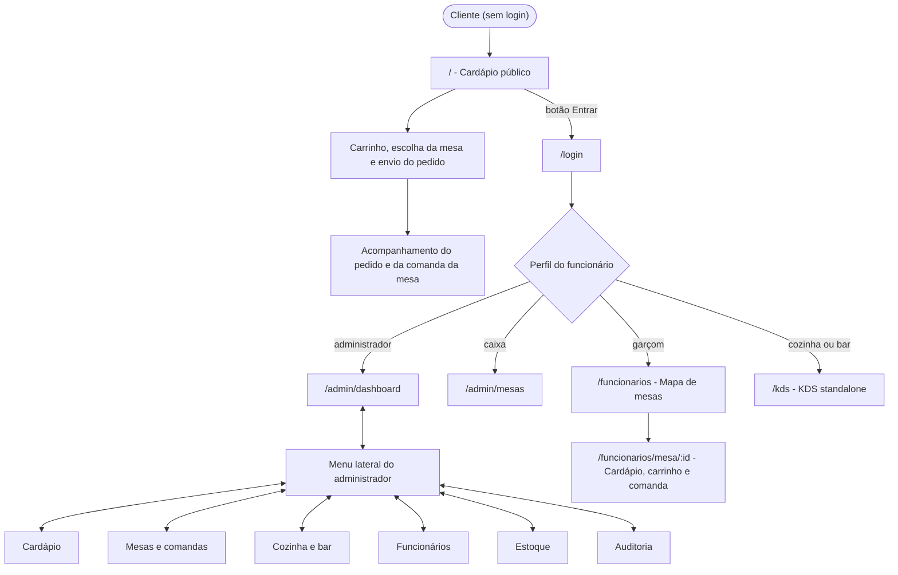
[Voltar para o início](#inicio)

# 7. Protótipo
- ### Link do protótipo com a ferramenta Figma: [Figma - ProntaComanda](https://www.figma.com/proto/DiucbOuIzhfo5k8jNEIjij/ProntaComanda?node-id=0-1&t=46LvV2O62RCQsEJs-1)

O protótipo serviu de base para a paleta, a tipografia e o layout das telas (os tokens de tema do front-end foram extraídos dele). Algumas telas prototipadas, como o perfil do usuário, não fazem parte do escopo implementado (ver seção [3.4](#34-alterações-de-escopo-em-relação-à-especificação-original)).

- ### Figura 2 - Protótipo da página principal Home:

  

- ### Figura 3 - Protótipo da tela de perfil do usuário:

  

[Voltar para o início](#inicio)

# 8. Aplicação
- ### Link para o nosso repositório do GitHub: [Repositório - ProntaComanda](https://github.com/BrunoOller/ProntaComanda)

O repositório reúne dois projetos independentes, `backend/` (API) e `frontend/` (interface), além dos arquivos de infraestrutura (`docker-compose.yml` e a pasta `k8s/`). Esta seção descreve o que foi construído; o passo a passo de instalação e os logins de demonstração estão no README do repositório da aplicação.

## 8.1. Arquitetura
O navegador acessa apenas o nginx, que serve os arquivos do front-end e repassa as chamadas de `/api`, `/uploads` e `/socket.io` para o back-end. O back-end acessa o MongoDB e grava as fotos dos produtos em um volume.

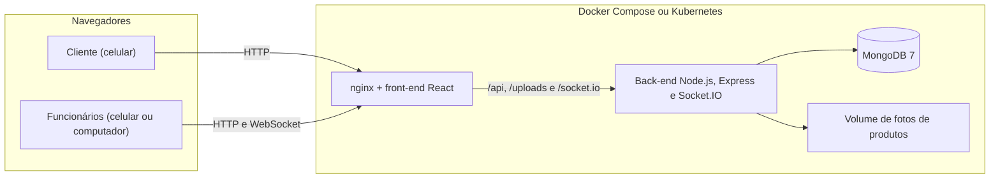

No back-end, cada requisição passa por uma sequência de camadas: **rotas** (que definem os endpoints e as permissões) → **middlewares** (autenticação JWT, controle de acesso por perfil, validação Zod e limite de requisições) → **controllers** (regras de negócio) → **models** (Mongoose). Erros são tratados por um middleware global, que registra os logs estruturados (Winston) e devolve mensagens amigáveis. Um job agendado (node-cron) faz a consolidação mensal. No front-end, as telas ficam em `pages/`, os componentes reutilizáveis em `components/`, o estado de sessão em um *store* (Zustand) e a conexão de tempo real em um *hook* (`useSocket`).

## 8.2. Tecnologias

| Camada | Tecnologias |
|--------|-------------|
| Front-end | React 18, Vite 5, Tailwind CSS 3, React Router 6, Zustand, React Hook Form com Zod, Axios, Socket.IO Client, ApexCharts (gráficos) e jsPDF (relatório em PDF) |
| Back-end | Node.js 22, Express 4, Mongoose 8 sobre MongoDB 7, Socket.IO 4, jsonwebtoken e argon2 (autenticação), Zod (validação), Multer (upload de fotos), node-cron, Winston (logs), Helmet e express-rate-limit (segurança) |
| Infraestrutura | Docker e Docker Compose, nginx, Kubernetes (manifestos com Kustomize) e GitHub Actions (integração contínua que compila as imagens) |
| Design | Figma, Tailwind CSS, fontes Archivo Black e Rubik |

## 8.3. Módulos e telas

| Tela | Rota | Perfis | O que faz |
|------|------|--------|-----------|
| Cardápio público | `/` | Cliente (sem login) | Cardápio por categoria com busca, carrinho, escolha da mesa, envio do pedido, acompanhamento de cada item e comanda compartilhada da mesa |
| Login | `/login` | Funcionários | Entrada por CPF e senha; leva cada perfil à sua tela inicial |
| Dashboard | `/admin/dashboard` | Administrador | Indicadores por período (hoje, semana, mês), faturamento dos últimos 12 meses, status dos pedidos, top 5 produtos e exportação em PDF |
| Cardápio (gestão) | `/admin/cardapio` | Administrador | Cadastro de categorias e produtos (foto, setor, tempo de preparo, ingredientes), disponibilidade, filtro por setor e busca |
| Mesas e comandas | `/admin/mesas` | Administrador, Caixa | Mapa de mesas e painel da mesa: abrir comanda, lançar item, estornar, fechar mesa ou comanda, fila de pedidos de clientes. O administrador também aplica desconto, reabre mesas e cria ou remove mesas |
| Cozinha e bar | `/admin/cozinha` | Administrador | Supervisão do KDS, com abas por setor |
| Funcionários | `/admin/funcionarios` | Administrador | Cadastro, edição, desligamento e reativação |
| Estoque | `/admin/estoque` | Administrador | Insumos, entradas, saídas, ajustes por contagem e histórico de movimentações, com alerta de zerado e abaixo do mínimo |
| Auditoria | `/admin/auditoria` | Administrador | Consulta paginada dos registros, filtrável por tipo, funcionário e período |
| Mapa de mesas (mobile) | `/funcionarios` | Garçom, Caixa, Administrador | Mesas por status, abertura de mesa, fila de pedidos de clientes e indicador de conexão em tempo real |
| Mesa (mobile) | `/funcionarios/mesa/:mesaId` | Garçom, Caixa, Administrador | Cardápio com busca, carrinho, escolha da comanda, nova comanda, sugestão de observações, consumo da mesa e solicitação de fechamento |
| KDS | `/kds` | Cozinha, Bar, Administrador | Pedidos do setor com semáforo de tempo, filtros (novo, em preparo, pronto, atrasado), busca e avanço de status em lote |

<!-- Capturas de tela das telas acima podem ser inseridas aqui, em uma nova subseção de figuras. -->

## 8.4. API e tempo real
Todas as rotas ficam sob `/api` e exigem o cookie de sessão, exceto o login, o cardápio público e as rotas de autoatendimento. Erros seguem o formato `{ "erro": "mensagem" }`.

| Módulo | Prefixo | Acesso |
|--------|---------|--------|
| Autenticação | `/auth` | Público (login e logout); `me` exige login |
| Funcionários | `/funcionarios` | Administrador |
| Categorias e produtos | `/categorias`, `/produtos` | Leitura: qualquer perfil logado; escrita e upload de foto: Administrador |
| Cardápio | `/cardapio` | Público |
| Mesas | `/mesas` | Leitura: logado; abrir e solicitar fechamento: Garçom, Caixa, Administrador; criar, remover e reabrir: Administrador |
| Comandas | `/comandas` | Lançar e transferir itens: Garçom, Caixa, Administrador; KDS: Cozinha, Bar, Administrador; estorno: Caixa, Administrador; desconto: Administrador |
| Pagamentos | `/pagamentos` | Caixa, Administrador |
| Estoque | `/estoque` | Administrador |
| Dashboard e auditoria | `/dashboard`, `/auditoria` | Administrador |
| Autoatendimento | `/publico` | Público, com limite de requisições por IP |
| Pedidos de cliente | `/pedidos-cliente` | Garçom, Caixa, Administrador |

Os eventos em tempo real (Socket.IO) mantêm as telas dos funcionários atualizadas sem recarregar a página:

| Evento | Sala | Quando ocorre |
|--------|------|---------------|
| `mesa:atualizada` | `mapa-mesas` | O status de uma mesa muda |
| `mesa:aguardando-fechamento` | `caixa` | O garçom solicita o fechamento da mesa |
| `kds:novo-item` | `cozinha` ou `bar` | Um item é lançado ou um pedido de cliente é aceito |
| `kds:status-atualizado` | todos | O estágio de preparo de um item muda |
| `produto:atualizado` | todos | A disponibilidade de um produto muda (manual ou por estoque) |
| `pedido-cliente:novo` e `pedido-cliente:resolvido` | `pedidos-cliente` | Um pedido de cliente chega ou é aceito/recusado |

A tela do cliente não usa WebSocket: ela consulta o andamento dos pedidos periodicamente.

## 8.5. Execução e implantação
Há três formas de executar o sistema (detalhadas no README do repositório da aplicação):

| Forma | Quando usar |
|-------|-------------|
| **Docker Compose** | A mais simples: um comando sobe o MongoDB, o back-end e o front-end, acessíveis em `http://localhost:8080` |
| **Kubernetes** | Demonstração da infraestrutura: MongoDB com disco próprio, back-end e front-end com 2 réplicas, com auto-recuperação |
| **Sem Docker** | Desenvolvimento local, com Node 22 e MongoDB; o front-end atualiza sozinho ao salvar |

O comando de dados de exemplo (*seed*) cria usuários de todos os perfis, cardápio e mesas para demonstração. A configuração fornecida é **de demonstração, não de produção**: o MongoDB fica sem senha, o site roda em HTTP e o back-end usa `NODE_ENV=development`.

## 8.6. Situação atual do projeto
**Funcional:** login e controle de acesso por perfil; cadastros de funcionários, categorias, produtos, insumos e mesas; autoatendimento por QR code com confirmação do garçom; fluxo completo de mesa (abrir, lançar, KDS, estornar, desconto, pagar, reabrir); módulo mobile do garçom; KDS por setor com semáforo; estoque com histórico; dashboard com PDF; auditoria; consolidação mensal; execução em Docker Compose e Kubernetes.

**Pendências conhecidas:**

| Área | Pendência |
|------|-----------|
| Funcionalidades | Vínculo produto-insumo (ficha técnica) ainda não configurável: sem ele, a indisponibilização automática por estoque não dispara e o lançamento de item não dá baixa no estoque |
| | Transferência de itens entre comandas existe só na API, sem tela |
| | Reabertura é por mesa; fechar por engano uma comanda avulsa não tem desfazer |
| | O QR code é único para o estabelecimento (o cliente escolhe a mesa e o garçom confere) e é gerado fora do sistema; falta QR code por mesa |
| | Fora do escopo atual: reserva de mesas, cortesia, taxa de serviço e exportação em CSV; emissão de vias impressas da conta é opcional |
| Validações | Desconto aceita percentual acima de 100 ou negativo; comanda já paga ainda aceita desconto, estorno e transferência; o estorno aceita motivo de 1 caractere; as rotas de comanda não usam validação Zod; o endpoint de status do KDS não valida o valor nem impede voltar atrás |
| Segurança | Socket.IO sem autenticação (qualquer cliente conectado pode entrar nas salas internas); dependências com vulnerabilidades conhecidas (`npm audit`) |
| Qualidade | Sem testes automatizados; documentação Swagger/OpenAPI não escrita (a biblioteca já está instalada) |
| Dados e infraestrutura | Backup segmentado com `mongodump` e revisão de índices; o back-end só suporta uma réplica (tempo real, job mensal e fotos locais) |
| Interface | Refino visual das telas para coincidir com o Figma |

[Voltar para o início](#inicio)

# 9. Diagramas da aplicação
Os diagramas da aplicação representam de forma visual a estrutura e o funcionamento do sistema, auxiliando na compreensão e no planejamento do projeto. Por meio da notação UML, é possível visualizar as principais interações, classes e entidades do banco de dados, facilitando o entendimento entre todos os envolvidos no desenvolvimento.

## 9.1. Diagrama de Casos de Uso
Mostra como os usuários interagem com o sistema e quais são as principais funcionalidades disponíveis. Ajuda a identificar os papéis dos atores e os fluxos de uso da aplicação. As setas tracejadas indicam que o ator herda as funções do outro (o Caixa faz tudo o que o Garçom faz, e o Administrador faz tudo o que o Caixa, a Cozinha e o Bar fazem).

### Figura 6 - Diagrama de Casos de Uso:
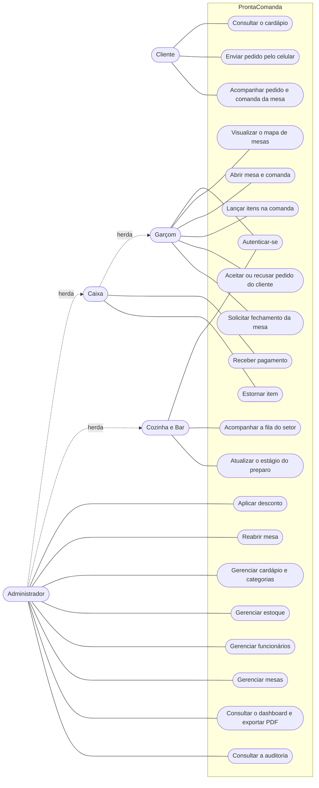

## 9.2. Diagrama de Classes
Apresenta a estrutura interna do sistema, mostrando as classes, seus atributos e relacionamentos. Permite compreender a organização do código e a relação entre os componentes. Os modelos guardam apenas dados; as operações (abrir comanda, pagar, estornar etc.) ficam nos controllers do back-end.

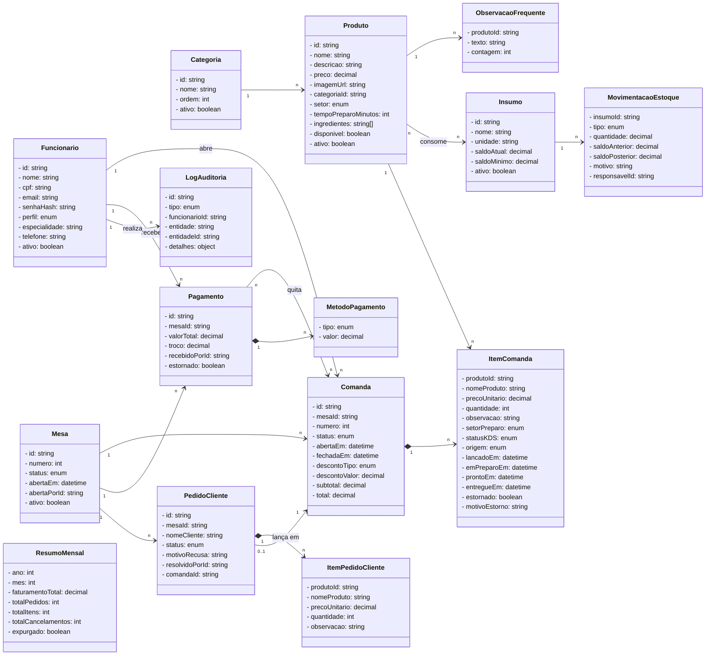

> Observação: como o banco é orientado a documentos (MongoDB), os itens da comanda (`ItemComanda`), os itens do pedido do cliente (`ItemPedidoCliente`) e as formas de pagamento (`MetodoPagamento`) ficam embutidos dentro do documento pai (relação de composição). O vínculo `Produto` e `Insumo` (ficha técnica) existe no modelo, mas ainda não pode ser configurado pela aplicação.

## 9.3. Diagrama de Banco de Dados
Representa as coleções e os relacionamentos que compõem a base de dados do sistema. Serve para planejar e documentar a forma como as informações são armazenadas e conectadas. Os itens embutidos aparecem como entidades separadas apenas para facilitar a leitura.

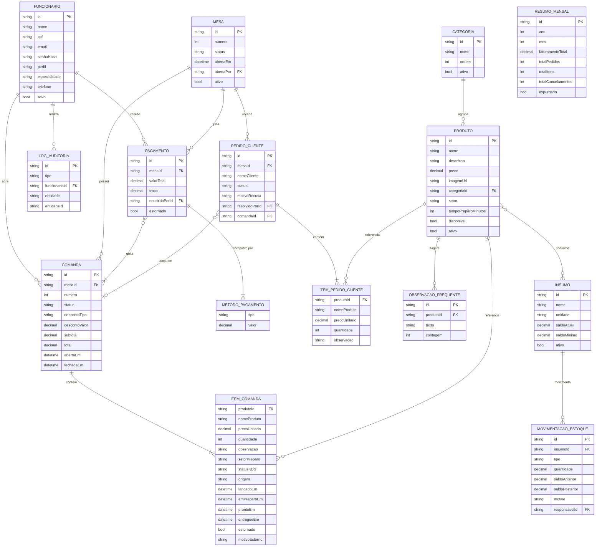

## 9.4. Diagramas de Estados
Mostram os estados pelos quais passam as principais entidades e o que provoca cada mudança.

**Mesa**
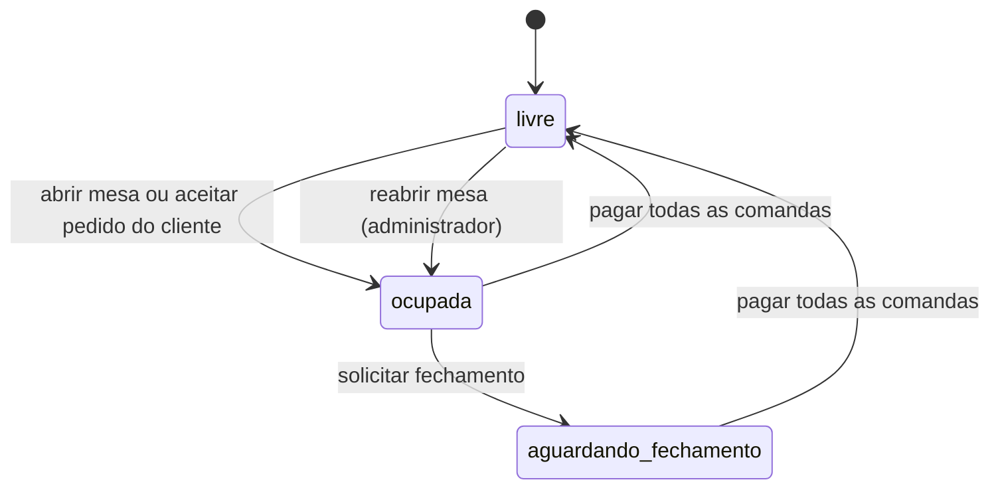

**Item da comanda (KDS)**
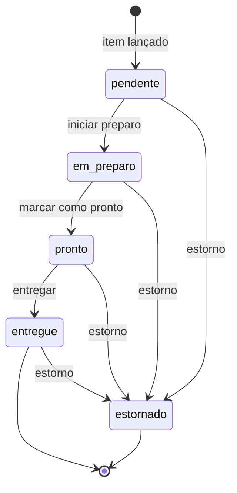

**Pedido do cliente**
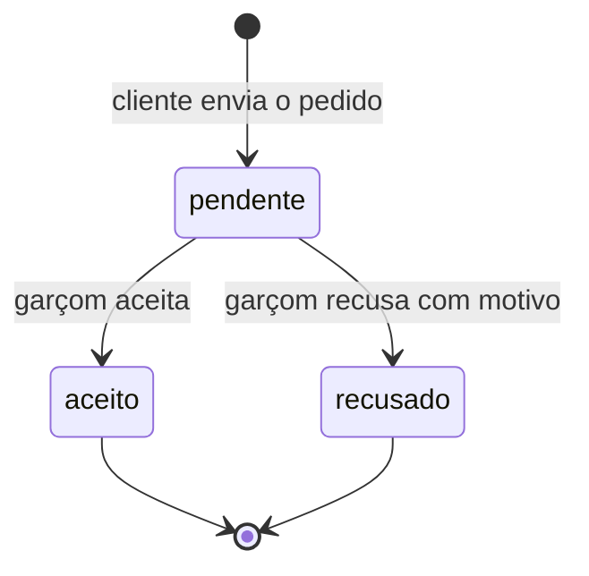

**Comanda**
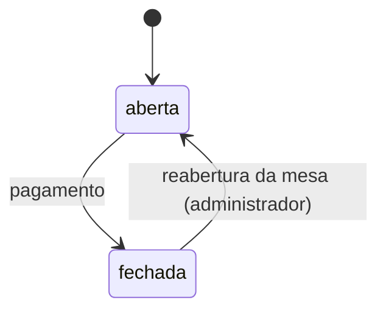

## 9.5. Diagramas de Sequência
**Pedido feito pelo cliente (autoatendimento)**
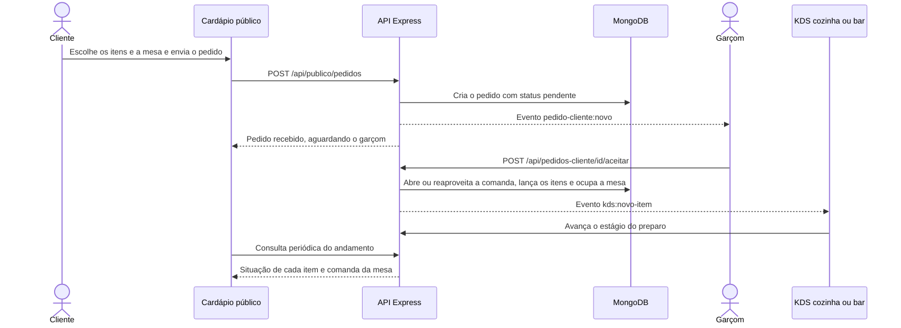

**Atendimento no salão, produção e fechamento da conta**
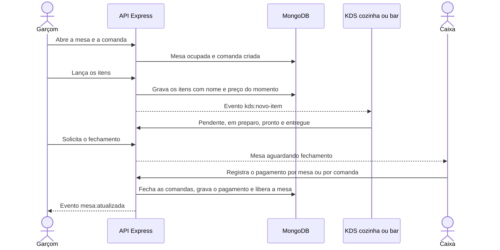

[Voltar para o início](#inicio)

# 10. Considerações finais

A aplicação **ProntaComanda** foi concebida com o objetivo de modernizar e agilizar a gestão de atendimento em estabelecimentos gastronômicos, oferecendo uma solução integrada para o controle de mesas, cardápios e esteira de preparação em tempo real (KDS). Ao utilizar uma arquitetura desacoplada, com **React** e **Tailwind CSS** no front-end e **Node.js** e **Express** no back-end com comunicação via **Socket.IO**, o projeto elimina as limitações de sistemas tradicionais baseados em papel ou em atualizações manuais de página, permitindo o fluxo de dados instantâneo entre o salão, a cozinha e o caixa.

A adoção do banco de dados NoSQL **MongoDB** (com Mongoose) viabilizou uma persistência de dados orientada a documentos, flexível e performática. Isso permitiu tratar adequadamente estruturas características do setor de *Food Service*, como comandas com itens embutidos, preços e nomes preservados no momento do lançamento, estoque de insumos com histórico e auditoria de estornos, descontos e reaberturas. Além do atendimento tradicional pelo garçom, o sistema incorporou o autoatendimento por QR code, no qual o cliente pede e acompanha o consumo pelo celular e o garçom confere cada pedido antes de ele seguir para a produção. O desenvolvimento desse ecossistema proporcionou desafios práticos enriquecedores em engenharia de software, englobando desde o controle de acesso baseado em perfis (RBAC) e a segurança da autenticação até a sincronização de eventos em tempo real e a execução em contêineres (Docker e Kubernetes).

Em suma, o ProntaComanda cumpre o seu propósito ao eliminar falhas de comunicação, reduzir o tempo de espera dos clientes e otimizar a eficiência operacional no setor gastronômico. Como o escopo evoluiu ao longo do projeto, algumas funcionalidades previstas inicialmente (reserva de mesas, cortesia, taxa de serviço e exportação em CSV) ficaram fora da versão atual, e há melhorias identificadas como trabalhos futuros: vínculo entre produtos e insumos com baixa automática de estoque, tela para transferência de itens entre comandas, autenticação nas conexões de tempo real, QR code por mesa, testes automatizados, backup do banco de dados e documentação da API. O projeto não apenas entrega uma ferramenta funcional para o mercado, mas também consolida o aprendizado prático da equipe no desenvolvimento de aplicações web modernas, na construção de APIs RESTful e na integração com bancos de dados não relacionais.

[Voltar para o início](#inicio)

---

# Referências bibliográficas

DOCKER, Inc. Docker Documentation. 2026. Disponível em: <https://docs.docker.com/>. Acesso em: 21 nov. 2026.

EXPRESS. Express - Framework web rápido, flexível e minimalista para Node.js. 2026. Disponível em: <https://expressjs.com/>. Acesso em: 28 set. 2026.

FIGMA, Inc. Figma: the collaborative interface design tool. 2026. Disponível em: <https://www.figma.com/>. Acesso em: 28 set. 2026.

MIND THE GRAPH. O que é um estudo de viabilidade em pesquisa? 2023. Disponível em: <https://mindthegraph.com/blog/pt/o-que-e-um-estudo-de-viabilidade-em-pesquisa/>. Acesso em: 28 set. 2026.

MONGODB, Inc. MongoDB: The Application Data Platform. 2026. Disponível em: <https://www.mongodb.com/>. Acesso em: 28 set. 2026.

MONGOOSE. Mongoose - Elegant MongoDB object modeling for Node.js. 2026. Disponível em: <https://mongoosejs.com/>. Acesso em: 21 nov. 2026.

NODE.JS FOUNDATION. Node.js v22 LTS Documentation. 2026. Disponível em: <https://nodejs.org/>. Acesso em: 21 nov. 2026.

REACT. React – Uma biblioteca JavaScript para criar interfaces de usuário. 2026. Disponível em: <https://react.dev/>. Acesso em: 28 set. 2026.

SOCKET.IO. Socket.IO: Bidirectional and low-latency communication for every platform. 2026. Disponível em: <https://socket.io/>. Acesso em: 28 set. 2026.

TAILWIND LABS INC. Tailwind CSS - Rapidly build modern websites without ever leaving your HTML. 2026. Disponível em: <https://tailwindcss.com/>. Acesso em: 28 set. 2026.

THE KUBERNETES AUTHORS. Kubernetes Documentation. 2026. Disponível em: <https://kubernetes.io/docs/>. Acesso em: 21 nov. 2026.

TRELLO. Trello: Organize anything with anyone, anywhere. 2026. Disponível em: <https://trello.com/>. Acesso em: 28 set. 2026.

VITE. Vite - Next Generation Frontend Tooling. 2026. Disponível em: <https://vite.dev/>. Acesso em: 21 nov. 2026.

[Voltar para o início](#inicio)
